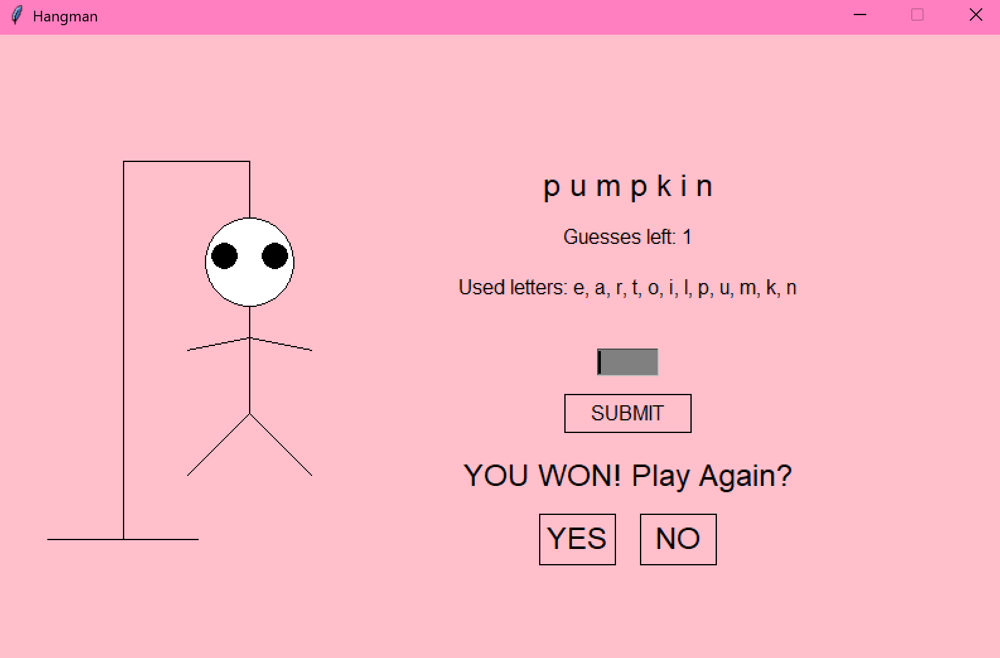

# Python Hangman Game

A Hangman game I made in Python for a class project. I originally made a console version and later added a graphical version for extra credit.

## Features
- Randomly selects words from a text file
- Allows players to guess letters
- Tracks correct and incorrect guesses
- Checks for wins and losses
- Graphical version with a pink background and interactive buttons
- Hangman drawing that updates with incorrect guesses
- Option to play again in the graphical version

## Concepts Used
- Python
- Lists, loops, and functions
- File I/O
- Random word selection
- Input validation
- Zelle's graphics library
- Mouse input and GUI elements

## How to Run
1. Download the Python file and `hangmanwords.txt`.
2. Make sure Zelle's `graphics.py` library is available.
3. Run the Python file.
4. Enter letters in the console or use the graphical interface to play.

The console version runs using `play_game()`, while the graphical version runs using `graphics_hangman()`.

## Preview

## Credits
I developed this project for a Python class assignment
